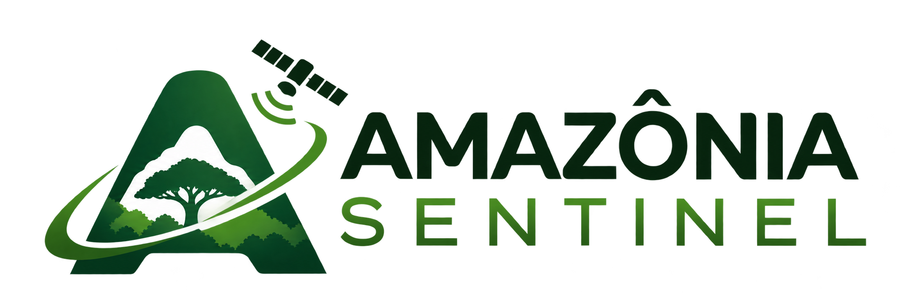

Plataforma MVP chamada Amazônia Sentinel de inteligência geoespacial para monitorar a degradação florestal na Amazônia, detectando alterações por meio de imagens de satélite, dados ambientais oficiais e indicadores de risco.

<p align="center">
  
  
  
</p>

## Visão geral

O projeto Amazônia Sentinel nasce da necessidade de transformar a observação da floresta em uma análise evidenciada, rastreável e útil para tomada de decisão. Em vez de responder apenas "onde a floresta mudou", o sistema busca responder:

- o que ocorreu;
- quanto foi afetado;
- quando isso aconteceu;
- qual é a evidência de sensoriamento remoto;
- como a ocorrência se relaciona com autorizações ambientais e contextos legais.

A solução combina imagens ópticas e de radar, focos térmicos, áreas monitoradas e dados geoespaciais para identificar sinais de degradação, como incêndios, corte seletivo, efeito de borda e quedas massivas de árvores. O objetivo do MVP é demonstrar a viabilidade da abordagem em uma interface interativa de mapeamento e painel analítico.

## Equipe - Grupo 14

| Nome | Perfil |
|---|---|
| Ana Beatriz Santana | [](https://www.linkedin.com/in/ana-beatriz-santana-2592a7348) |
| Fabiane Santiago | [](https://www.linkedin.com/in/fabiane-santiago-302b6370) |
| Júlia D'Angelo | [](https://www.linkedin.com/in/júliadangelo?utm_source=share_via&utm_content=profile&utm_medium=member_ios) |
| Thiago Stevam | [](https://github.com/Thx03) |


## Problema e motivação

A degradação florestal na Amazônia nem sempre resulta na remoção total da cobertura vegetal. Alterações sutis, como incêndios de baixa intensidade, cortes seletivos, bordas fragmentadas e quedas agrupadas, podem passar despercebidas quando os dados estão fragmentados ou quando não há correlação entre imagens e registros ambientais.

O desafio central do projeto é integrar várias fontes de informação em uma mesma linha de análise, permitindo uma avaliação mais confiável do que foi observado no território e o que pode estar associado a atividades autorizadas ou não autorizadas.

## Objetivos do MVP

- Detectar alterações relacionadas a vetores prioritários de degradação.
- Delimitar espacialmente eventos e gerar séries temporais antes/depois.
- Quantificar extensão, intensidade e frequência de eventos observados.
- Comparar ocorrências com polígonos e dados de contexto ambiental.
- Apresentar alertas e indicadores em um dashboard geoespacial.
- Registrar evidências para revisão humana, sem substituir a validação jurídica ou técnica final.

## Funcionalidades principais

- Mapa interativo com camadas geoespaciais e overlays por ano.
- Visualização de áreas de interesse e histórico temporal.
- Cálculo de área e suporte para indicadores de degradação.
- Integração de dados de referência, como PRODES/DETER, MapBiomas e dados ambientais oficiais.
- Comparação entre contexto territorial e ocorrência observada.
- Estrutura preparada para evoluir para alertas automáticos e priorização de investigação.

## Arquitetura conceitual

O MVP foi pensado como uma plataforma de análise multissensor e multiescala, composta por:

- ingestão de dados geoespaciais e ambientais;
- processamento e normalização de camadas;
- análise temporal e espacial de alterações;
- avaliação de evidências e atributos de risco;
- painel interativo para inspeção e priorização.

A ideia não é emitir um veredicto automático de ilegalidade, mas sim fornecer uma trilha de evidência para apoio técnico, ambiental e operacional.

## Stack tecnológica

- Python para processamento geoespacial e scripts de análise.
- HTML, CSS e JavaScript para interface web interativa.
- Leaflet para mapear camadas e interações no navegador.
- Shapely, PyProj e PyShp para manipulação e geoprocessamento.
- Estrutura de dados orientada a séries temporais e geometrias.

## Como executar o MVP

### 1) Preparar ambiente

```bash
python -m venv .venv
source .venv/bin/activate   # Linux/macOS
# ou
.venv\Scripts\activate      # Windows
pip install -r requirements.txt
```

### 2) Servir a interface

```bash
python -m http.server 8000
```

Em seguida, abra no navegador:

```text
http://localhost:8000/index.html
```

### 3) Executar scripts de processamento

Os módulos Python podem ser executados individualmente conforme a etapa da análise, como processamento de áreas, geração de mapas e integração de camadas geoespaciais.

## Limitações e cuidados

- O projeto é um MVP e ainda depende de validação em cenários reais de dados e piloto operacional.
- Dados de satélite podem ser afetados por nuvens, resolução espacial, cobertura temporal e qualidade de aquisição.
- A detecção por imagem não equivale automaticamente a evidência legal de infração.
- O sistema deve ser usado como apoio técnico para investigação, com revisão humana e contextualização documental.

## Próximos passos

- aprimorar a classificação de eventos por tipo e severidade;
- incorporar mais fontes oficiais e dados temporais;
- fortalecer a correlação entre área observada e autorizações ambientais;
- criar alertas automatizados para áreas prioritárias;
- evoluir para uma camada de validação e triagem com revisão humana.

## Conclusão

O Amazônia Sentinel representa uma proposta de produto orientada a vigilância ambiental e apoio à gestão territorial. O foco do MVP é demonstrar que é possível unir sensoriamento remoto, geoprocessamento e visualização em uma solução prática, rastreável e útil para a compreensão da degradação florestal na Amazônia.
